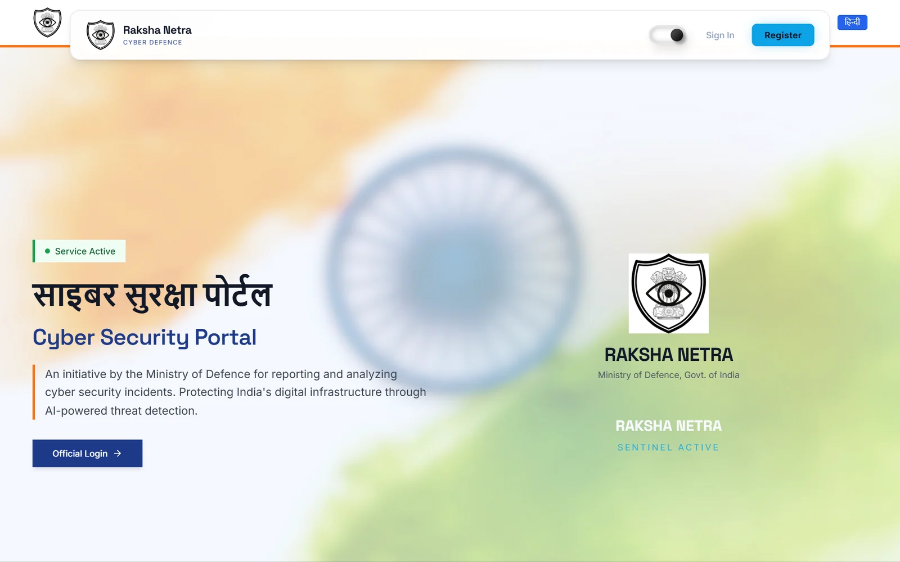
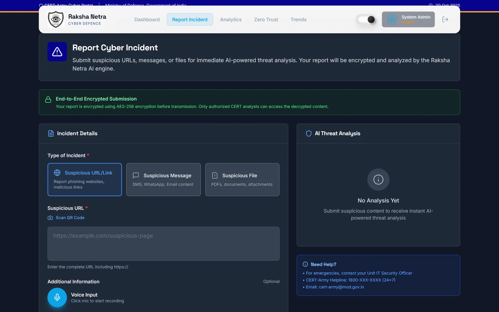
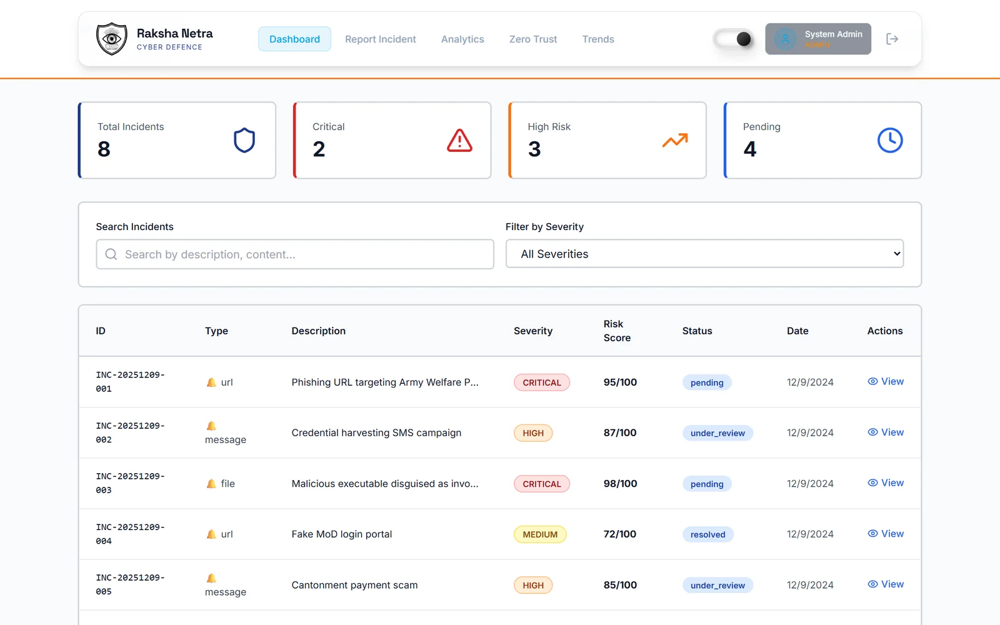
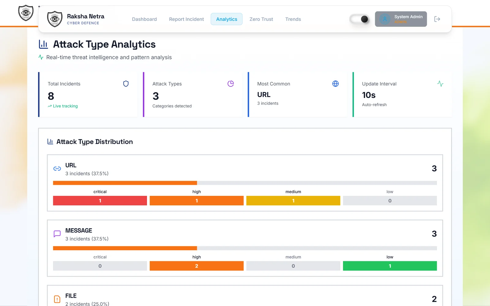
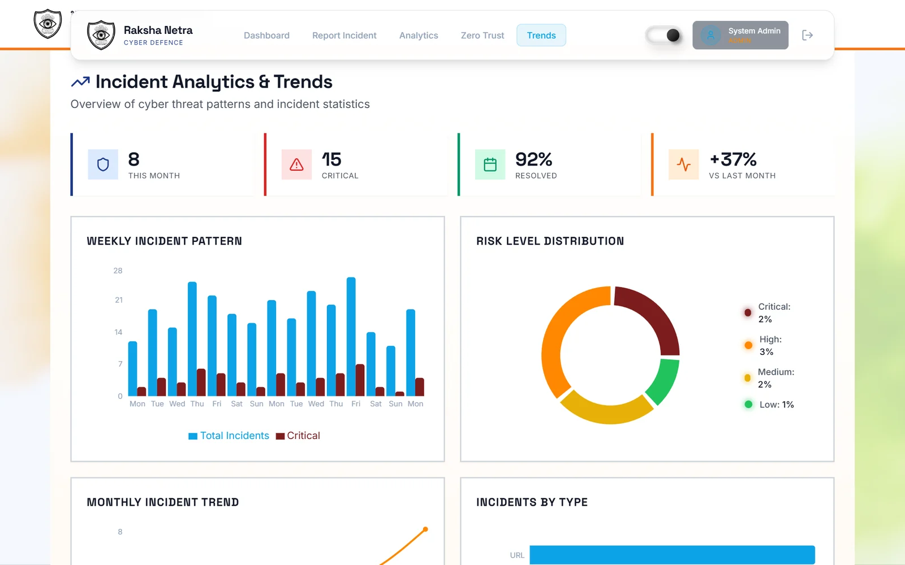
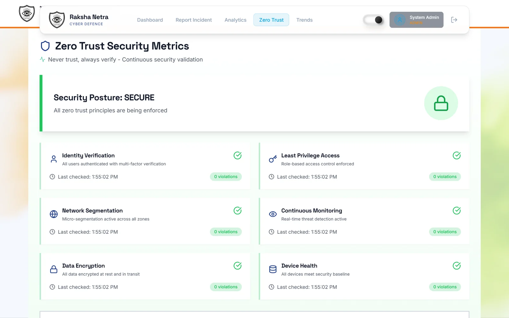
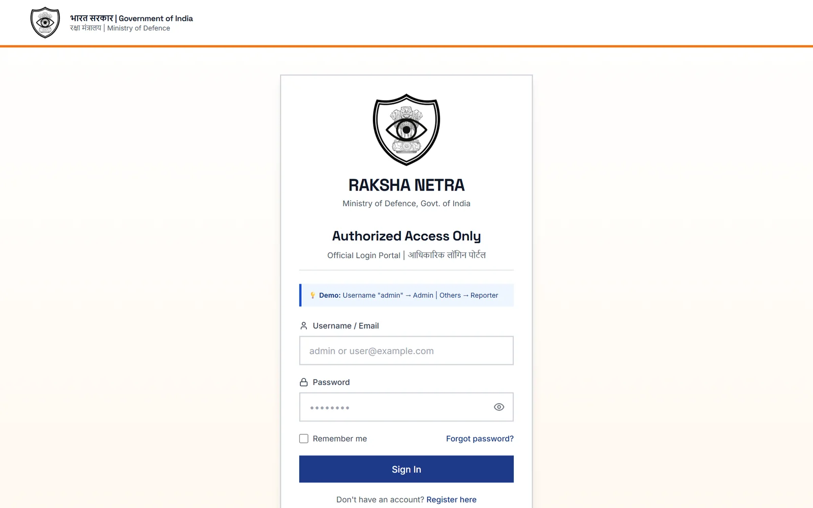

<div align="center">

# Raksha Netra (WatchTower)

**A cyber incident reporting portal for defence personnel. Report a suspicious link, message or file; get an AI risk analysis; let CERT analysts triage it.**

Smart India Hackathon 2025



</div>

## What it does

Raksha Netra gives defence personnel a quick way to report phishing links, fake payment messages and malicious files, and gives the CERT team one place to triage them:

1. A reporter submits a suspicious URL, message or file, with optional voice input.
2. The backend scores it: NLP on the text, static file analysis in a sandbox (with VirusTotal), threat matching, and an AI summary.
3. Admins and analysts see every incident on a dashboard, open the full analysis, and escalate.

## Screens

<table>
  <tr>
    <td width="50%"></td>
    <td width="50%"></td>
  </tr>
  <tr>
    <td><b>Report cyber incident.</b> Suspicious URL, message or file, with an end-to-end encrypted submission notice.</td>
    <td><b>Dashboard.</b> Totals, critical and high-risk counts, and a searchable incident table with risk scores.</td>
  </tr>
  <tr>
    <td></td>
    <td></td>
  </tr>
  <tr>
    <td><b>Attack type analytics.</b> Incidents by type and severity, refreshed every 10 seconds.</td>
    <td><b>Trends.</b> Weekly pattern, risk-level distribution, monthly trend and incidents by type.</td>
  </tr>
  <tr>
    <td></td>
    <td></td>
  </tr>
  <tr>
    <td><b>Zero trust.</b> Identity verification, least privilege, segmentation, encryption and device health checks.</td>
    <td><b>Official login.</b> Role-based access for reporters and admins.</td>
  </tr>
</table>

## Architecture

```
React + Vite frontend  ──►  FastAPI backend (backend/server.py)
                              ├─ /api/auth        login, register, refresh, me
                              ├─ /api/incidents   submit, list, details, analysis, escalate
                              ├─ /api/analytics   stats, trends, risk distribution
                              └─ modules/
                                   nlp_analyzer       entities, urgency, sentiment
                                   sandbox_analyzer   static file analysis, VirusTotal
                                   evidence_vault     chain-of-custody file retention
                                   threat_matcher     known-threat matching
                                   zero_trust         device fingerprinting, risk-based access
                                   auto_escalation, incident_playbook, geo_intelligence, audit_logger
```

## Run locally

Requires Node 20+ and Python 3.10+. On Windows, `SETUP.ps1` installs everything and `START.bat` starts both servers. By hand:

```bash
# backend
cd backend
pip install -r requirements.txt
python server.py

# frontend (new terminal, repo root)
npm install --legacy-peer-deps
npm run dev
```

Demo accounts (password `demo123`): `reporter@army.mil` (reporter) and `admin@rakshanetra.mil` (admin). Full guide: [SETUP_GUIDE.md](SETUP_GUIDE.md).

## Tech stack

**Frontend:** React, TypeScript, Vite, Tailwind CSS, shadcn/ui, Recharts, React Leaflet.
**Backend:** Python, FastAPI, Google Generative AI, VirusTotal API.

## Team

Built for SIH 2025 with [euphoric-habromaniac](https://github.com/euphoric-habromaniac). An earlier version of the portal is [watchtower-sentinel](https://github.com/Chandankumar775/watchtower-sentinel).
